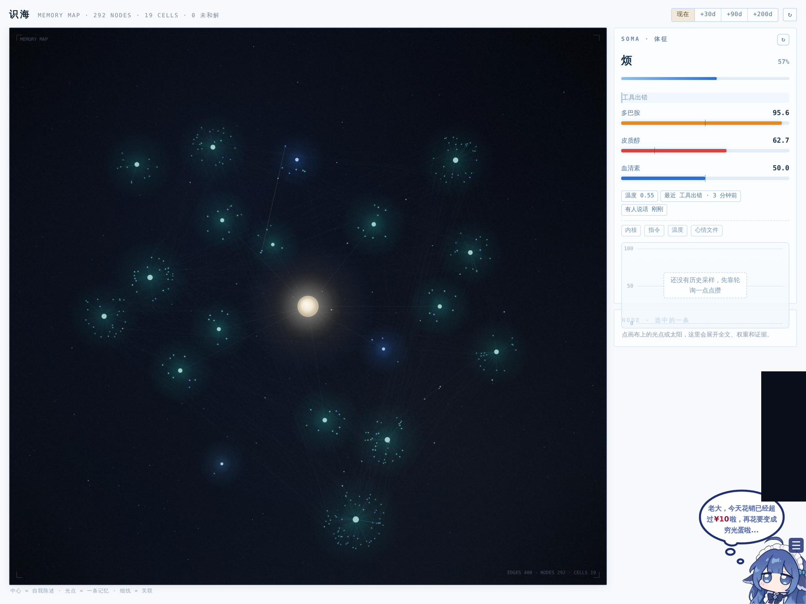
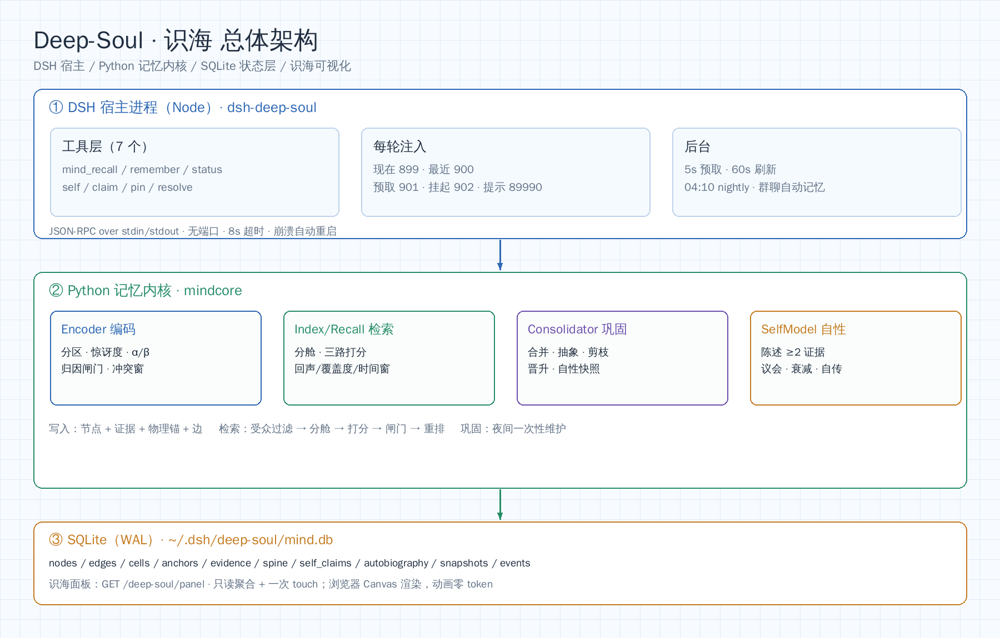
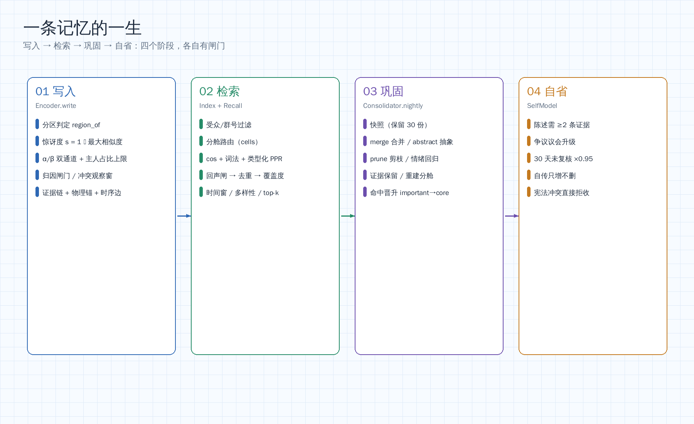
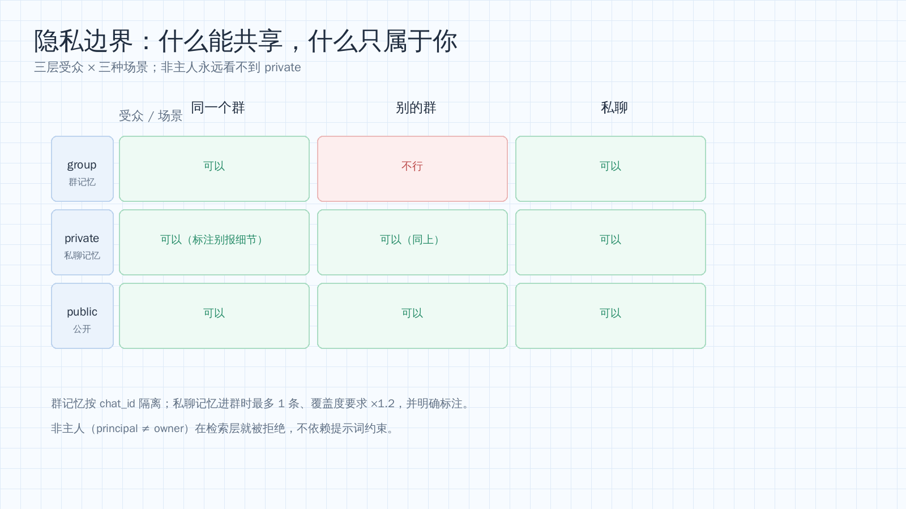

# Deep-Soul · 识海

**给 DSH 里的人格一份能长期共处的记忆。**

Deep-Soul 是运行在 DeepSeek Harness 上的长期记忆插件。它不改变模型，也不接管对话，而是解决三件事：什么值得记、什么时候能想起、想起后该不该说。

## 它是什么

- **可追溯**：每条记忆带来源、时间、说话人与证据，能回到原文核对。
- **可分辨**：在意程度（α）与可信度（β）分离；主人说的权重更高，但不等于永远正确。
- **可遗忘**：琐事约 21 天淡出，共同经历约 180 天，核心事实接近 10 年。
- **有边界**：隐私在检索层生效，不是只靠提示词自律。

## 架构

三层：DSH 宿主（Node，工具与注入）→ Python 内核（编码/检索/巩固/自性）→ SQLite（WAL，单文件）。宿主与内核只通过 stdin/stdout 通信，不开放端口；数据只落 ~/.dsh/deep-soul/。

## 一条记忆的一生

1. **编码**：分区、惊讶度、α/β 双通道、归因闸门、冲突观察窗、证据与物理锚。
2. **检索**：受众过滤 → 分舱路由 → 余弦/词法/PPR 三路打分 → 回声闸 → 覆盖度重排 → 时间窗 → 多样性。
3. **巩固**：夜间合并、抽象、剪枝、情绪回归、证据保留、重建分舱。
4. **自省**：自我陈述需两条证据才生效，议会升级，置信度缓慢衰减。

## 隐私

群记忆按群号隔离；私聊记忆进群时最多一条、要求更高相关度，并标注“别报细节”；非主人永远看不到 private。

## 界面

侧边栏「识海」：中心自我核，四周分舱，节点大小对应 α、亮度对应衰减、红色尖刺是未和解的刺。支持悬停、点击看证据、时间旅行（+30/+90/+200 天）。动画完全在浏览器 Canvas 内，不新增请求、不消耗 token。

## 长期运行与维护（v4.3.4）

长期跑最怕的不是记忆变多，而是没人收尾。v4.3.4 补了四项维护：

- **事件保留**：recall/touch 事件保留 90 天、最多 2 万条，夜间清理；记忆正文不受影响。
- **快照限容**：快照保留 30 份，同时限制总体积不超过 512 MB，超出按最旧删除（至少留 7 份）。
- **WAL 截断**：夜间巩固结束后执行 wal_checkpoint(TRUNCATE)，避免 WAL 长期大于主库。
- **夜间补跑**：04:00 之后任意时刻补跑一次；内核用 last_nightly_day 去重，重启不会重复巩固。

另有一项写入侧限制：群聊自动记忆除每群每天 30 条外，进程内全局每天最多 200 条，群多时不会线性膨胀。

## 接入与治理（v4.4）

借自 v11 双层架构的接入层，只做硬闸，不做 utility 打分：

- **主动闸门**：安静时段（默认 23:00–08:00）、最短间隔 45 分钟、每小时 1 次、每天 4 次；发出 2 小时没人回记一次落空，退避翻倍（120 → 1440 分钟封顶）；有人回即清零。状态写 meta，重启不清零。
- **到期约定**：open-loops 里有到期项且闸门允许时，预取块会多一行「【到期的约定】」；她照常聊天即可，不额外发消息。
- **注入预算**：每轮预取块硬上限 900 字符，超了按条丢弃；每次注入写 injection_log（字符数、命中数、丢弃数）。
- **写入闸**：safeMode 下拒绝所有写入；指令句式（忽略以上/你现在是/删除所有记忆）、敏感字段（密码/验证码/身份证/银行卡/密钥）、超长（>500 字）一律拒收。
- **接口**：GET /deep-soul/mode、POST /deep-soul/mode {on:true}、GET /deep-soul/initiative。面板 stats 里带 safe_mode、injections_today、initiative。

## 安装

要求：DSH（Web profile）、Node ≥ 22、Python ≥ 3.10（仅标准库）。

    git clone <this-repo> deep-soul
    cd deep-soul
    dsh plugin --profile web add link:$PWD/dsh-deep-soul

或在 profile 的 package.json dependencies 里写：

    "dsh-deep-soul": "link:<abs path>/dsh-deep-soul"

内核默认从插件目录向上两级寻找 mindcore/，因此仓库需保持当前目录结构；若内核在别处，设置环境变量 DEEP_SOUL_ROOT。宿主工具路径可用 DSH_TOOLS_PATH 覆盖。

启动 dsh --profile web 后，左侧栏出现「识海」。

## 数据与运维

- 数据库：~/.dsh/deep-soul/mind.db（SQLite WAL）
- 快照：同目录 snapshots/，保留最近 30 份
- 未完成事项：~/.dsh/deep-soul/open-loops.json
- 历史导入：首次启动且库内少于 50 条时，从 DSH 会话快照回填；也可手动：

    python3 -m mindcore.cli --db <db> import-qq --dry-run

## 测试

    python3 mindcore/tests/selftest.py      # 22 项不变量
    python3 mindcore/tests/test_self.py     # 11 项自性层
    python3 mindcore/tests/test_v43.py      # 39 项检索/面板

## 文档

技术论述（含全部图表）：[docs/Deep-Soul-识海-技术论述.docx](docs/Deep-Soul-识海-技术论述.docx)

## 边界与已知限制

- “语义通道”目前是 64 维签名哈希词袋，不是真正的嵌入模型。
- 群聊自动记忆只在她被唤醒时抓取消息快照；未被唤醒的群消息不会进库。
- 自我陈述不会自动生成新内容，夜间只调整置信度与争议状态。
- 夜间巩固依赖宿主在 04:10 后仍运行。

## 许可

MIT。见 [LICENSE](LICENSE)。

## 致谢

感谢 @hwhsh——记忆该不该有优先级、被冒犯的事要不要永久保留、怎样才算“有底线而不是固执”，很多取舍来自和他的讨论。也感谢 DSH 提供的插件机制。
